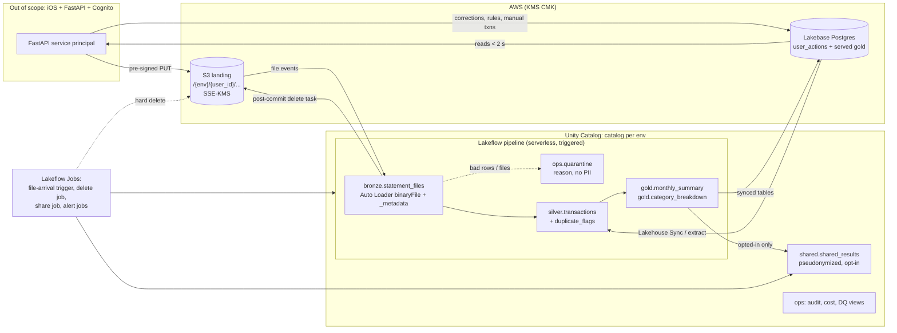

# Porygon Finance Pilot: Databricks Data Platform — Plan for approval

Status: **DRAFT, awaiting approval. No platform code has been written.**
Source: `docs/foundry-spec.pdf` (Foundry build-ready spec, session c0918e1e, bundle items 1, 2, 6, 7, 8, 11; every item is marked low confidence and "needs human review").

---

## 1. My understanding of the spec

**Product.** iPhone-only, English-only, USD pilot for 10 salaried people in Panama City, one bank each (Banco General, Banistmo, BAC, Global Bank), about 3 months of history plus ongoing uploads. The dashboard shows income, spending and savings for the month, a category breakdown with month-over-month change, a transaction list for fixing categories, and a duplicate review list.

**Success metric.** Savings rate up by more than 5 percentage points. The spec defines savings as:

```
savings      = transfers_to_savings + (income − spending_excluding_savings_transfers)
savings_rate = savings / income
```

Two consequences for the data design:
- Savings-transfer rows are excluded from spending and added back once as savings. A transfer must never also reduce the leftover amount, or it counts twice.
- Spending can exceed income, so savings and the savings rate can be negative.

**Privacy promises (hard requirements).** Only the owner sees their data. There is no operator access. Account deletion is a hard delete with no soft-delete retention, finishing within minutes. Sharing is per-user opt-in, off by default, carries no transaction details, and is removed on opt-out or deletion. Raw statement files are deleted after parsing.

**Business rules to implement:**
- Categorization: user store rule, then merchant keyword map, then "Other".
- Duplicates: same amount, date within 3 days, similar description. Flag only, never auto-delete. Unresolved duplicates count once in totals until the user decides. Rejected pairs are never re-flagged.
- Income: recurring salary-like credits. Quincena (two deposits) counts both. If no salary is detected, the user enters the income (`monthly_income_override`).
- Edge cases: wrong bank or unsupported file, empty or corrupted file, overlapping uploads, spending greater than income.

**The spec's architecture.** The AWS API plus RDS Postgres is the system of record. S3 is only for uploads. Databricks is an optional sink for opt-in results and is not on the critical path.

**Spec data model fragments I'll honor as the API contract:**
- `transactions(id, user_id, date, description, merchant_key, amount, direction, category_id, source[upload|manual], is_savings_transfer, is_income, created_at)`
- `duplicate_flags(id, user_id, txn_a, txn_b, status[pending|confirmed|rejected])`
- `store_rules(id, user_id, merchant_key, category_id)`
- `monthly_income_override(user_id, month, amount)`
- `shared_results(user_pseudonym, month, savings_rate)`
- API reads: `GET /summary?month=`, `GET /breakdown?month=`.

---

## 2. Deviations from the spec, and conflicts this creates

You asked for Databricks as the data plane from ingestion to gold. That is a deviation from the spec's "not on the critical path". These are the conflicts, each with a proposal.

| # | Spec requirement | Conflict | Proposal | Your call |
|---|---|---|---|---|
| D1 | Dashboard < 2 s | Serving gold from a SQL warehouse risks cold starts and queueing. | Serve gold through **Lakebase synced tables** (managed Postgres, read-only copy of gold). The API reads Postgres. Fallback: export gold to the app's RDS via a job. | Lakebase vs. export |
| D2 | 3-month import < 30 s | A serverless pipeline update has start-up time and a multi-stage flow. Expect about 1–3 minutes end to end. I can't promise 30 s on Databricks. | Change the UX to "processing, ready in about 2 min" (async), or relax the NFR to about 3 min. Alternative: a thin synchronous parse in the API, which means two parser implementations. I don't recommend that. | **Needs a decision** |
| D3 | Corrections "reflect immediately" (income, category, duplicates, manual add). The spec's own estimate is two taps. | These are low-latency writes. Delta and pipelines are the wrong write path. | Treat app-mutable state (`store_rules`, `income_override`, `duplicate_decisions`, manual transactions, `is_savings_transfer` tags) as **user_actions in Lakebase (OLTP)**. A triggered pipeline folds them into silver and gold. For immediacy, the API recomputes the affected month's summary (cheap, since the formula is simple) while Databricks remains the reproducible source of truth. Reconcile them with a test. | Confirm this split |
| D4 | Raw file deleted after parsing | `cloudFiles.cleanSource` is documented with a retention window (default 30 days; DELETE needs more than 7 days) and is documented mainly as a cost-reduction for directory listing. It is not "delete immediately after commit". | Add an explicit **post-commit delete task** in the job (delete the S3 object after the bronze write commits), plus an S3 lifecycle rule (1 day) as a backstop. I'll test whether `cleanSource` works with file events before using it at all. | Confirm approach |
| D5 | Hard delete within minutes, no soft-delete | Delta history, deletion vectors, streaming checkpoints, system-table logs and S3 versions all keep traces. | Deletion job: DELETE in every table, then `REORG … APPLY (PURGE)`, then `VACUUM` with a short retention (target 0–24 h; I'll document it). Downstream streaming tables read with `skipChangeCommits`, or I use materialized views for gold. Backups: documented short retention (ADR). | Confirm retention |
| D6 | No operator access | Databricks workspace/metastore admins and AWS admins can grant themselves access. Policy alone is not a privacy promise. | Defense in depth: (1) CMK (KMS) on S3 and UC managed storage, key policy limited to the pipeline and API service principals; (2) metastore admin is a group, break-glass only, time-boxed; (3) audit alert on any non-service-principal read of user data; (4) row filters and column masks. I'll write this honestly in the ADR: a determined cloud root admin can still change a key policy, but it is audited. | Accept residual risk |
| D7 | Founder preference vs. cost (the spec itself lists this as a named tension) | A Databricks data plane adds fixed costs (Lakebase, warehouses, monitoring) that a lean backend wouldn't have. | Section 5. I'll keep everything serverless and scale-to-zero where possible. | See cost |
| D8 | Spec states "no PDF unless confirmed" | Bank formats are unknown (Open Question 2). | Build the parsers behind a plugin interface driven by per-bank config. No fixtures are real. I'll ask for **redacted or hand-made samples** from each bank's export layout. | Provide format samples |

---

## 3. Proposed architecture



**Layers.**
- **Landing.** Private S3 bucket, SSE-KMS CMK, per-user prefix, bucket policy denies non-TLS. Registered as a UC external location and volume.
- **Bronze.** Auto Loader in file-events mode, `binaryFile` format, `_metadata` captured. Per-bank parsers (pure Python, run inside the pipeline) convert files to rows. XLSX parsing uses openpyxl in the parser rather than depending on Databricks' built-in Excel reader, which is Beta and needs DBR 17.1+. I'd revisit once it's GA.
- **Silver.** Normalized `transactions` with deterministic keys, `merchant_key`, category, direction, `is_income`, `is_savings_transfer`. Duplicate flags go in a separate table. Bad rows go to `ops.quarantine` with a reason code.
- **Gold.** Monthly summary and category breakdown with month-over-month change, per user, as materialized views or AUTO CDC targets. Liquid clustering on `(user_id, month)`.
- **Shared.** Separate schema, fed only for opted-in users, salted-hash pseudonym (salt in a secret scope), with the agreed fields only.
- **Governance.** One catalog per env, with schemas `bronze`, `silver`, `gold`, `shared`, `ops`. Owners are groups or service principals. Grants, tags and comments are all in the bundle.

---

## 4. Feature status check (verified against current docs this session)

| Feature | What I found | Plan |
|---|---|---|
| Lakeflow Declarative Pipelines | Now called **Lakeflow Spark Declarative Pipelines** (SDP). AUTO CDC is the current name for APPLY CHANGES. | Use SDP and AUTO CDC naming. |
| Auto Loader file events | Recommended over directory listing. | Use. I'll confirm the exact GA status when I build slice 1. |
| `cloudFiles.cleanSource` | DBR 16.4+. DELETE/MOVE with a retention window. Not clear whether it works with file events. | Don't rely on it (D4). |
| Built-in Excel reader | DBR 17.1+, labelled Beta in at least one doc version. No schema evolution; one header row. | Parse XLSX in Python (openpyxl). |
| Lakebase | GA on AWS (secondary sources; I'll confirm against the release notes). Synced tables copy a UC table into Postgres read-only and need a primary key. Lakehouse Sync (Postgres to Delta) is **Beta, AWS only**. | Use synced tables for serving. Treat Lakehouse Sync as a risk with a fallback: a scheduled extract. |
| Row filters and column masks on pipeline tables | Release notes say pipelines now keep them across updates. | Use. |
| ABAC with governed tags | **Not confirmed.** | I'll check the UC docs before relying on it. Fallback: explicit row filters. |
| `skipChangeCommits` | A streaming-read option. Its interaction with AUTO CDC sources still needs confirming. | Test in slice 5. |

Sources: [Auto Loader options](https://docs.databricks.com/en/ingestion/cloud-object-storage/auto-loader/options.html), [Excel on Databricks](https://docs.databricks.com/aws/en/query/formats/excel), [Lakebase synced tables](https://docs.databricks.com/aws/en/oltp/sync-data/sync-table), [SDP release notes 2026](https://docs.databricks.com/aws/pt/release-notes/dlt/2026).

---

## 5. Cost estimate (rough: verify with the Databricks and AWS pricing calculators before committing)

I could not find current per-DBU prices in my searches, so these are order-of-magnitude figures and not quotes.

| Item | Run cost / month (pilot) | Notes |
|---|---|---|
| Serverless pipeline and job runs | about $20–60 | 10 users, a few uploads a month, a couple of minutes each, triggered only. |
| Lakebase (serving + user_actions) | about $50–150 | The largest line. Use the smallest size and scale to zero if the dashboard latency allows. |
| SQL warehouse (alerts, audit and cost dashboards) | about $20–60 | Smallest serverless warehouse, auto-stop 1 min. |
| Lakehouse monitoring | about $10–30 | Only on gold and silver. |
| S3, KMS, logs | under $10 | Tiny data volume. |
| **Total run** | **about $100–300 / month** | A lean RDS-only design would cost about $30–50. |

**Build.** Most of the $10k is engineering time. Databricks dev and staging add about $100–200 per month. Budget about 4 months of dev/staging/prod, roughly $1k, with the rest left for labor. Cost levers: scale-to-zero, no always-on clusters, one shared dev workspace, and a budget alert at 70%.

---

## 6. Phased plan (your six slices)

1. **Bundle skeleton, UC and CI.** `databricks.yml` with `dev` (development mode, per developer), `staging`, `prod`. Catalog, schemas, volume, external location, groups and grants, tags. GitHub Actions: ruff, mypy, pytest, `bundle validate`, deploy to staging, integration tests, gated prod deploy, authenticated with OIDC service principals. ADR-001..004.
2. **One bank, S3 to gold.** Pick a bank (Banco General, subject to samples). Parser, bronze, silver, gold, quarantine, expectations, fixtures, tests.
3. **Remaining banks.** Three more parser modules plus fixtures. No refactor.
4. **Categorization, duplicates, income, savings.** Keyword config, store rules, duplicate detector with 3-day window in config, income detection (quincena, no-salary), the no-double-count test suite.
5. **Deletion and shared results.** Hard-delete job with purge and the "no rows or files remain" test, opt-in share job with pseudonyms and minimum group size, Lakebase serving and sync.
6. **Monitoring.** Event-log views, failure and duration alerts, freshness/volume/schema-drift checks, `system.billing` cost view and budget alert, `system.access.audit` view and alert.

Each slice is deployed to `dev`, tested with synthetic data, and ends with a summary.

---

## 7. Open questions and assumptions (becomes `docs/open-questions.md`)

All assumptions are configurable and none is silently chosen.

| # | Question | Blocks | My assumption (configurable) |
|---|---|---|---|
| Q1 | Statement formats and samples per bank (spec Q2) | Slice 2 | XLSX/CSV only; per-bank YAML for header row, columns, date format, sign convention, decimal separator. No PDF. |
| Q2 | Accuracy tolerance (spec Q3) | Duplicates, dashboard | Month is the transaction date as stated by the bank; no tolerance. |
| Q3 | Shared-result payload (spec Q4/Q5) | Slice 5 | `(pseudonym, month, savings_rate)` only, as in the spec's data model. No category totals. Minimum cohort size before any aggregate is shown: 5 (config). With 10 users, re-identification risk is high and I will say so in the ADR. |
| Q4 | Category list (spec Q6) | Slice 4 | A placeholder set (Groceries, Dining out, Transport, Utilities, Health, Shopping, Entertainment, Education, Housing, Other), in a reference table. Needs your approval. |
| Q5 | Savings-transfer detection (spec Q7) | Slice 4 | Both: keyword and own-account rules from config, plus a user tag. |
| Q6 | No salary detected (spec Q8) | Slice 4 | Flag `income_missing`; use `monthly_income_override`; no savings rate until set. |
| Q7 | Where do user corrections live? (D3) | Slice 2 | Lakebase `user_actions`. |
| Q8 | Import latency NFR (D2) | Slice 2 | Async, about 2–3 minutes. |
| Q9 | Retention numbers (D5) | Slice 5 | Delta history/VACUUM 0–24 h after deletion; raw files deleted right after commit; S3 versioning off on the landing bucket; logs contain no PII. |
| Q10 | What are the founder's "existing Databricks integrations"? (spec Q5) | Slice 5 | None assumed. |
| Q11 | Amount sign and currency conventions per bank | Slice 2 | Debit negative, credit positive after normalization. |
| Q12 | Does the app write the file or does the platform pre-sign the PUT? | Slice 1 | The API issues a pre-signed PUT, scoped to the user prefix. |
| Q13 | AWS account, region, Databricks workspace and existing identity setup | Slice 1 | New account per env or shared with prefixes. Unknown. |

---

## 8. Decisions I need from you before I start

1. **D1/D3: Lakebase** as the serving and OLTP layer for corrections (recommended), versus exporting gold to the app's RDS?
2. **D2:** Accept asynchronous import (about 2–3 minutes) instead of the 30 s NFR?
3. **D4:** Explicit post-commit delete task instead of `cleanSource`?
4. **Slice 2 bank:** Banco General first?
5. **Environments:** One Databricks workspace with a catalog per env, or a workspace per env? (I recommend one workspace per env for `staging`/`prod`, but it costs more.)
6. **Samples:** Can you provide the column layouts (headers only, with fake values) for each bank's export?
